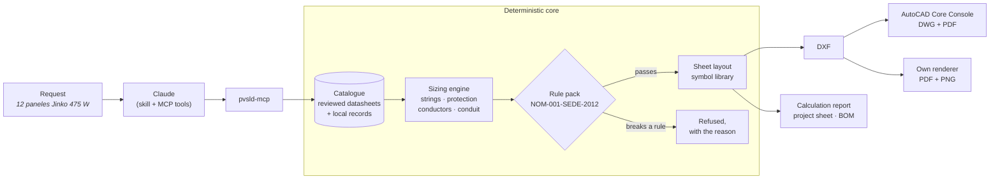

<h1 align="center">PvUnifilar</h1>

<p align="center">
  <b>From one sentence to a complete PV interconnection package for Mexico.</b><br>
  Single-line diagram (DWG / DXF / PDF), calculation report, editable project sheet and bill of materials,<br>
  sized and checked against NOM-001-SEDE-2012 and drawn with CFE symbology, by Claude through MCP.
</p>

<p align="center">
  <a href="https://github.com/edu3250/Diagrama-unifilarAutoCAD/actions/workflows/ci.yml"></a>
  
  
  
  
  
</p>

<p align="center">
  <a href="plugins/pv-unifilar/README.md"><b>Guía en español del plugin →</b></a>
</p>

> **"Hazme un diagrama unifilar con 12 paneles Jinko de 475 W"**

<p align="center">
  
</p>

<p align="center"><sub>The sheet that request produces, drawn by the system (the names on it are fictitious). 12 × 475 W = 5.70 kWp on a 4.6 kW inverter, DC/AC 1.24.</sub></p>

---

## What you get

One request, one folder per project:

| | Deliverable | With AutoCAD | Without AutoCAD |
|---|---|---|---|
| 📐 | **Editable drawing** | DWG 2018 and DXF | DXF |
| 🖨️ | **Drawing PDF** (A3) | plotted by AutoCAD | vector PDF rendered by the tool |
| 🧮 | **Calculation report** (memoria de cálculo) | Excel with live formulas, and PDF | same |
| 📋 | **Project sheet** (hoja de proyecto) | Excel, prefilled, to fix any value | same |
| 🧾 | **Bill of materials** | in the chat and as text | same |
| 💬 | **Why this inverter** | one plain sentence | same |

AutoCAD is optional. Nothing is ever guessed: equipment comes from a catalogue of reviewed datasheet records, every value is computed by deterministic code, and a design that breaks a rule is refused with the reason.

## The drawing

Claude never draws a line. A deterministic core sizes the system, validates it against a versioned Mexican rule pack and lays out the sheet, so the same request always gives the same drawing.

<p align="center">
  
</p>

<table>
<tr>
<td width="34%" valign="top">

</td>
<td valign="top">

**A DC protection box, sized string by string**

- A gPV fuse-disconnector per string, chosen from the catalogue inside the NOM window (≥ 1.56 × Isc, ≤ the module's maximum series fuse). A DC breaker per string is the alternative.
- A surge protective device fed by every string, to earth.
- One ganged switch-disconnector ahead of the inverter.
- Every symbol is a block of the project's own library, with ports and attributes, so the DWG stays editable.

</td>
</tr>
<tr>
<td colspan="2">


**A protection schedule that matches the drawing.** Each device with its poles, rating, voltage, interrupting rating and location, taken from the same data the schematic is drawn from.
</td>
</tr>
<tr>
<td colspan="2">


**The numbers a reviewer looks for, on the sheet.** Cold Voc against the inverter, the MPPT window, 1.25 × Isc, the 120 % busbar rule, and per circuit: conductors, EMT conduit with its fill, ampacity and voltage drop.
</td>
</tr>
<tr>
<td colspan="2">


**Your data, only if you give it.** Owner, address, RPU, responsible engineer and company reach the sheet and the report exactly as you write them; anything you leave out stays a blank line to fill by hand. Nothing personal is ever invented.
</td>
</tr>
</table>

## The calculation report

An Excel workbook whose every result is a **live formula** over sourced inputs, with the limit, the verdict and the NOM reference on each line, plus the same report as a PDF. Change an input and the checks recalculate.

<p align="center">
  
</p>

## The project sheet: professional mode

Every design leaves an Excel **project sheet** behind. Yellow cells are yours; `AUTO` lets the calculation decide; the gray column shows what the last calculation chose and why. Fix the inverter, the strings, a fuse, a conductor size, the conduit or the service data, and ask for the design again.

<p align="center">
  
</p>

A value you fix is **kept and checked, never silently replaced**. If it breaks a rule, nothing is drawn: you get your own workbook back with the cell in red and the reason.

<p align="center">
  
</p>

## And in the chat

```text
RESUMEN DE LA INSTALACIÓN — 5.70 kWp / 4.60 kW CA (CD/CA 1.24)
Generación:
  Módulo fotovoltaico...............   12 pza  Jinko Solar JKM475N-60HL4, 475 W
  Inversor..........................    1 pza  Growatt MIN-4600TL-X2, 4.6 kW, 220 V
Caja de protecciones CD:
  Fusible gPV 10×38 mm..............    4 pza  Littelfuse SPF025 25 A, 1000 V cd
  Portafusible-seccionador..........    2 pza  2 polos, 10×38 mm, 1000 V cd
  Seccionador FV....................    1 pza  Suntree SISO-40-32 4 polos, 32 A, 600 V cd
  DPS de CD.........................    1 pza  Tipo T2, Ucpv 1000 V, In 20 kA
Conductores:
  Circuito C-S1.....................     50 m  10 AWG Cu PV 2 kV
  Circuito C-INV....................     90 m  8 AWG Cu THHW-LS
Canalización:
  Tubo EMT..........................     25 m  EMT 27 mm para C-S1
Lado CA:
  Interruptor termomagnético ITM-1..    1 pza  Square D QO230 2P 30 A, 10 kA
  ...
```

> *Se eligió el inversor Growatt MIN-4600TL-X2 (4.6 kW): con 5.70 kWp de módulos la relación CD/CA es 1.24, dentro del rango recomendado de 1.10 a 1.25.*

---

## Install the plugin (Claude Code)

**1. Requirements**

- [Claude Code](https://claude.com/claude-code) (terminal, desktop app or IDE extension).
- [uv](https://docs.astral.sh/uv/), which fetches Python and the server's dependencies:

  ```bash
  winget install --id=astral-sh.uv -e                 # Windows
  curl -LsSf https://astral.sh/uv/install.sh | sh     # macOS, Linux
  ```

  Close and reopen Claude Code after installing uv, so it finds `uvx`.
- AutoCAD on Windows is optional: with it you also get the DWG and the AutoCAD-plotted PDF.

**2. Install**

```text
/plugin install pv-unifilar --marketplace edu3250/Diagrama-unifilarAutoCAD@develop
```

> `v0.5.0rc1` is a pre-release, and its marketplace lives on the `develop` branch. From `v0.5.0` on, drop `@develop`.

**3. First start.** The first time, uv downloads about 60 MB of dependencies, which can take longer than the 30 seconds Claude Code waits for a server. If `/mcp` shows `pvsld` as failed, reconnect it there once the download ends, or warm it up beforehand in a terminal:

```bash
uvx --from git+https://github.com/edu3250/Diagrama-unifilarAutoCAD@v0.5.0rc1 pvsld-mcp --version
```

**4. Use it.** Ask in plain Spanish, or use the commands:

| Command | What it does |
|---|---|
| `/pv-unifilar:diagrama 12 paneles Jinko de 475 W` | **Quick mode.** The whole package from a simple request. A plain request in the chat triggers it too. |
| `/pv-unifilar:pro nuevo` | A blank project sheet to fix any value. |
| `/pv-unifilar:pro <project or sheet.xlsx>` | **Professional mode.** Designs from your filled sheet, or returns it with the cells to fix in red. |
| `/pv-unifilar:catalogo <datasheet.pdf>` | Adds equipment that is not in the catalogue to **your local catalogue**: Claude reads the datasheet, shows you the values, and saves them only after you confirm. |

Files go to `out/<project>/` in the folder where you work with Claude (configurable in `/config`). The Spanish guide is in [`plugins/pv-unifilar/README.md`](plugins/pv-unifilar/README.md).

## Use the MCP server directly

The plugin is a thin layer over a standard **stdio MCP server**, `pvsld-mcp`. Any MCP client can run it with the same command. It has been tested with Claude Code; other clients should work but have not been verified.

<details open>
<summary><b>Claude Code</b>, without the plugin</summary>

```bash
claude mcp add pvsld -- uvx --from git+https://github.com/edu3250/Diagrama-unifilarAutoCAD@v0.5.0rc1 pvsld-mcp
```

or in a project's `.mcp.json`:

```json
{
  "mcpServers": {
    "pvsld": {
      "command": "uvx",
      "args": ["--from", "git+https://github.com/edu3250/Diagrama-unifilarAutoCAD@v0.5.0rc1", "pvsld-mcp"],
      "env": { "PVSLD_OUTPUT_DIR": "out" }
    }
  }
}
```

</details>

<details>
<summary><b>Claude Desktop</b></summary>

Add the same server to `claude_desktop_config.json` (Settings → Developer → Edit Config), with an absolute output folder:

```json
{
  "mcpServers": {
    "pvsld": {
      "command": "uvx",
      "args": ["--from", "git+https://github.com/edu3250/Diagrama-unifilarAutoCAD@v0.5.0rc1", "pvsld-mcp"],
      "env": { "PVSLD_OUTPUT_DIR": "C:\\Users\\you\\Documents\\unifilares" }
    }
  }
}
```

</details>

<details>
<summary><b>VS Code (GitHub Copilot agent mode)</b></summary>

In `.vscode/mcp.json` the top-level key is `servers`:

```json
{
  "servers": {
    "pvsld": {
      "command": "uvx",
      "args": ["--from", "git+https://github.com/edu3250/Diagrama-unifilarAutoCAD@v0.5.0rc1", "pvsld-mcp"]
    }
  }
}
```

</details>

### Tools

| Tool | What it does |
|---|---|
| `design_and_draw` | **One step:** size, validate, draw, finish with AutoCAD (or render the PDF), write the calculation report, the project sheet and the bill of materials into one project folder. |
| `new_project_sheet` | Write a blank project sheet into a project folder. |
| `design_from_project_sheet` | Design from the filled sheet of a project, keeping every value the user fixed; or list the cells to fix and write the marked copy. |
| `list_components` | List the catalogue: PV modules, inverters, fuses, breakers, switches, cables (bundled and local). |
| `get_component` | Every datasheet value of one component, with its provenance (file, SHA-256, pages, reviewer). |
| `add_component_to_catalogue` | Add equipment to the user's local catalogue from its datasheet, after the user confirms the values. |
| `size_pv_system` | Size strings, protection, conductors and conduit; returns the selected design, ranked alternatives and every rejection with its rule. |
| `validate_pv_design` | Check a complete spec against the rule pack `mx-gd-2026.10`. |
| `generate_single_line_diagram` | Draw a validated spec as DXF, verify the file by reading it back and return a PNG preview. |

Tools take names, never paths: the server writes only inside its output folder, one sub-folder per project.

**Resources:** `pvsld://schema/pv-system-spec` (the spec JSON Schema), `pvsld://rulepack/mx-gd-2026.10` (the rules), `pvsld://symbols` (the symbol library), `pvsld://examples/sizing-template` and `pvsld://catalogue/record-examples` (the format of a catalogue record).

**Environment variables**

| Variable | Meaning | Default |
|---|---|---|
| `PVSLD_OUTPUT_DIR` | Where projects are written | `./out` |
| `PVSLD_LOCAL_CATALOGUE_DIR` | The user's own catalogue records and datasheets | `%APPDATA%\pvsld\catalogo`, or `~/.local/share/pvsld/catalogo` |
| `PVSLD_CATALOGUE_DIR` | The bundled catalogue | packaged with the server |
| `PVSLD_ACCORECONSOLE` | Path of `accoreconsole.exe` | the newest AutoCAD found |

### Step by step, when you want to choose

`design_and_draw` is the short path. The same server also lets Claude walk the design with you:

> Dimensiona un sistema de unos 10 kWp con módulos ET Solar de 550 W y el inversor que mejor convenga, enséñame las alternativas y luego genera el diagrama.

`list_components` → `size_pv_system` (selection, alternatives, rejections) → `validate_pv_design` → `generate_single_line_diagram`.

## Command line

The same engine without Claude:

```bash
pvsld design request.yaml -o out/casa            # everything in one step (quick mode)
pvsld pro new out/casa                           # a blank project sheet
pvsld pro design out/casa/hoja_de_proyecto.xlsx -o out/casa
pvsld catalogue list --type pv_module            # bundled and local records
pvsld catalogue add record.yaml --datasheet hoja.pdf
pvsld size request.yaml -o sized.yaml            # sizing only: selection, alternatives, rejections
pvsld validate spec.yaml && pvsld generate spec.yaml -o out/sld.dxf --png
pvsld finish out/sld.dxf                         # DXF -> DWG 2018 + PDF with AutoCAD Core Console
```

A request is three lines:

```yaml
module: JINKO-JKM475N-60HL4
module_count_min: 12
module_count_max: 12
```

## How it works



- **Claude collects and explains; it never computes or draws.** The tool surface has no drawing primitive and no code execution.
- **Catalogue.** Datasheet facts as validated records, each with the PDF's SHA-256, the pages and the reviewer. Missing equipment is added to a local catalogue from its datasheet, with the user's confirmation.
- **Sizing.** Enumerates the string layouts of the module on each inverter and rejects every one that breaks a voltage, MPPT-window, current or inverter-power limit. It prefers a DC/AC ratio of 1.10–1.25, then sizes the string protection, the conductors (ampacity and voltage drop) and the EMT conduit fill.
- **Rule pack `mx-gd-2026.10`.** Validates the complete design before anything is drawn. Ten rules so far, each with its citation: string voltage, MPPT window, short-circuit current, DC/AC ratio, conductor protection, conduit fill, the 120 % busbar rule, the bidirectional meter and the two disconnects CFE requires.
- **Output.** DXF R2018 verified by reading it back; DWG and PDF through the user's own AutoCAD when present.

Design decisions are recorded in [`docs/decisions/`](docs/decisions/), starting with [ADR-0001](docs/decisions/ADR-0001-claude-autocad-integration.md).

## Scope and limits

- Residential low voltage in Mexico: one string inverter, up to two strings, CFE service 1F-2H or 2F-3H, net metering by default.
- The bundled catalogue is small on purpose (every record is reviewed against its datasheet): Jinko and ET Solar modules, Growatt MIN and Huawei SUN2000 inverters, Littelfuse and Eaton gPV fuses, Schneider and Suntree DC breakers, a Suntree PV switch-disconnector, Square D QO breakers and Viakon PV wire. Anything else goes into your local catalogue from its datasheet.
- The plugin runs in Claude Code. It does not run on claude.ai in the browser, because the server works on your computer.
- DWG and the AutoCAD PDF need a licensed AutoCAD on Windows.

> [!IMPORTANT]
> **The drawings are drafts.** A responsible engineer must review and sign them before any submission to CFE or a verification unit. This project is not affiliated with CFE, Autodesk or any manufacturer.

## Development

```bash
git clone https://github.com/edu3250/Diagrama-unifilarAutoCAD.git
cd Diagrama-unifilarAutoCAD
git checkout develop
python -m venv .venv            # then activate it
pip install -e ".[dev]"

ruff check . && ruff format --check .
pytest --cov                    # AutoCAD tests are skipped unless --run-autocad
pvsld design examples/quick_request.yaml -o out/demo --no-autocad
```

- The repository's own `.mcp.json` runs the server from your checkout (`pvsld-mcp`, or point `PVSLD_MCP_COMMAND` at `.venv/Scripts/pvsld-mcp.exe`).
- CI runs the tests on Linux and Windows, builds the wheel and designs an installation with it outside the checkout, and validates the plugin with `claude plugin validate --strict`.
- Work follows GitFlow: see [`CONTRIBUTING.md`](CONTRIBUTING.md). Stages are tracked in [`IMPLEMENTATION_PLAN.md`](IMPLEMENTATION_PLAN.md), changes in [`CHANGELOG.md`](CHANGELOG.md).
- Background: the [Phase 1 research summary](docs/research/phase-1-summary.md), the [Phase 2 spike review](docs/spikes/phase-2-review.md) and the spike reports in [`docs/spikes/`](docs/spikes/).

| Release | Contents |
|---|---|
| `v0.5.0rc1` | Claude Code plugin, one-step design, calculation report, project sheet, local catalogue (pre-release) |
| `v0.4.0-symbols` | Symbol library and the A3 sheet template |
| `v0.2.0-spike` | MCP server, DXF backend, AutoCAD plug-in and Core Console finisher prototypes |
| `v0.1.0-docs` | Regulatory and integration research |

## License

MIT, see [`LICENSE`](LICENSE). Maintainer: [edu3250](https://github.com/edu3250). Contributions are welcome; please read [`CONTRIBUTING.md`](CONTRIBUTING.md) first.
