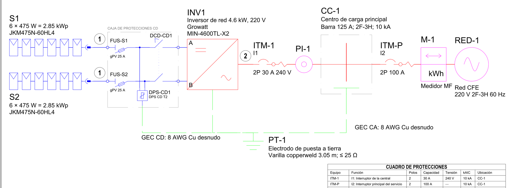
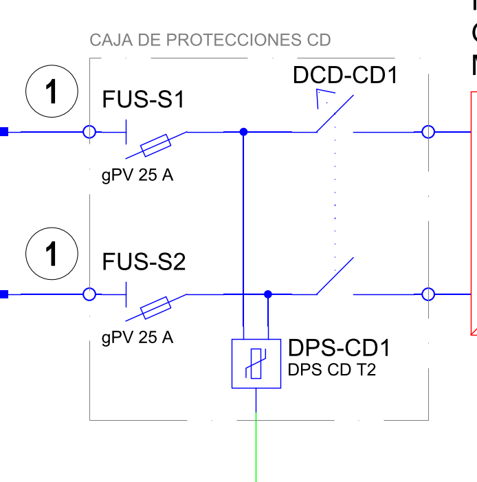
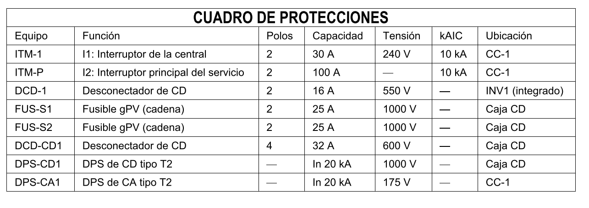
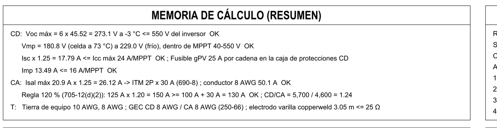
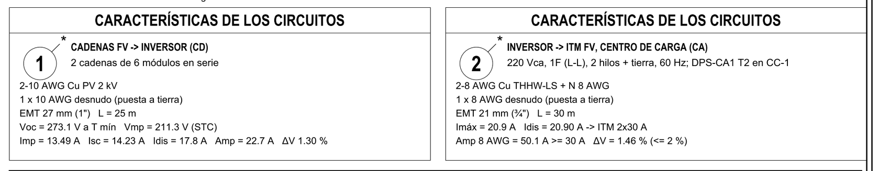
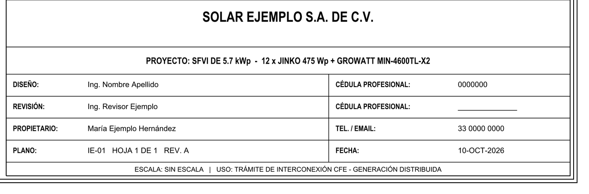
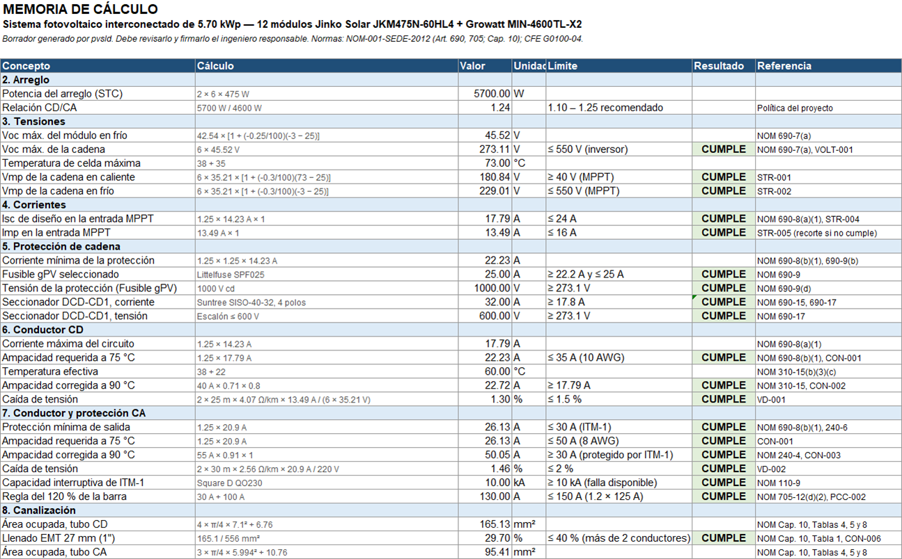
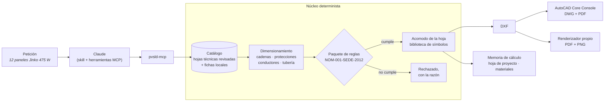

<h1 align="center">PvUnifilar</h1>

<p align="center">
  <b>De un simple prompt genera un diagrama unifilar fotovoltaico </b><br>
  Diagrama unifilar (DWG / DXF / PDF), memoria de cálculo, hoja de proyecto editable y resumen de materiales,<br>
  dimensionado y revisado contra la NOM-001-SEDE-2012 y dibujado con simbología CFE, por Claude a través de MCP.
</p>

<p align="center">
  <a href="https://github.com/edu3250/Diagrama-unifilarAutoCAD/actions/workflows/ci.yml"></a>
  
  
  
  
  
</p>

> **"Genera un diagrama unifilar con 12 paneles Jinko de 475 W"**

<p align="center">
  
</p>

<p align="center"><sub>El plano que produce esa petición, dibujado por el sistema (los nombres son ficticios). 12 × 475 W = 5.70 kWp con un inversor de 4.6 kW, relación CD/CA de 1.24.</sub></p>

---

## Qué entrega

Una petición, una carpeta por proyecto:

| | Entregable | Con AutoCAD | Sin AutoCAD |
|---|---|---|---|
| 📐 | **Plano editable** | DWG 2018 y DXF | DXF |
| 🖨️ | **Plano en PDF** (A3) | ploteado por AutoCAD | PDF vectorial generado por la herramienta |
| 🧮 | **Memoria de cálculo** | Excel con fórmulas vivas, y PDF | igual |
| 📋 | **Hoja de proyecto** | Excel ya llenado, para fijar cualquier valor | igual |
| 🧾 | **Resumen de materiales** | en el chat y como texto | igual |
| 💬 | **Por qué ese inversor** | una frase sencilla | igual |

AutoCAD es opcional. los equipos salen de un catálogo de fichas revisadas contra su hoja técnica, cada valor lo calcula código determinista, y un diseño que no cumple una regla se rechaza con su razón.

## El plano

Claude no dibuja ni una línea. Un núcleo determinista dimensiona el sistema, lo valida contra un paquete de reglas mexicano con versión y acomoda la hoja, así que la misma petición siempre da el mismo plano.

<p align="center">
  
</p>

<table>
<tr>
<td width="34%" valign="top">

</td>
<td valign="top">

**Caja de protecciones de CD, dimensionada cadena por cadena**

- Un fusible-seccionador gPV por cadena, elegido del catálogo dentro de la ventana de la NOM (≥ 1.56 × Isc, ≤ el fusible máximo en serie del módulo). La alternativa es un interruptor termomagnético de CD por cadena.
- Un supresor de picos (DPS) alimentado por todas las cadenas, a tierra.
- Un seccionador acoplado antes del inversor.
- Cada símbolo es un bloque de la biblioteca del proyecto, con puertos y atributos, así que el DWG se puede seguir editando.

</td>
</tr>
<tr>
<td colspan="2">


**Un cuadro de protecciones que coincide con el dibujo.** Cada dispositivo con sus polos, capacidad, tensión, capacidad interruptiva y ubicación, tomados de los mismos datos con los que se dibuja el esquema.
</td>
</tr>
<tr>
<td colspan="2">



**Los números que busca quien revisa, en el plano.** El Voc en frío contra el inversor, la ventana MPPT, 1.25 × Isc, la regla del 120 % de la barra y, por circuito: conductores, tubo EMT con su llenado, ampacidad y caída de tensión.
</td>
</tr>
<tr>
<td colspan="2">


**Tus datos, solo si los das.** Propietario, dirección, RPU, ingeniero responsable y empresa llegan al plano y a la memoria tal como los escribes; lo que no rellenes queda como línea en blanco para llenar a mano.
</td>
</tr>
</table>

## La memoria de cálculo

Un libro de Excel donde cada resultado es una **fórmula viva** sobre datos con su fuente, con el límite, el veredicto y la referencia de la NOM en cada renglón, más la misma memoria en PDF. Cambia un dato y las comprobaciones se recalculan.

<p align="center">
  
</p>

## La hoja de proyecto: modo profesional

Cada diseño deja una **hoja de proyecto** en Excel. Las celdas amarillas son tuyas; `AUTO` deja que el cálculo decida; la columna gris muestra qué eligió el último cálculo y por qué. Fija el inversor, las cadenas, un fusible, un calibre, la tubería o los datos del servicio, y vuelve a pedir el diseño.

<p align="center">
  
</p>

Lo que fijas **se respeta y se revisa; nunca se cambia en silencio**. Si no cumple una regla, no se dibuja nada: recibes tu misma hoja con la celda en rojo y la razón.

<p align="center">
  
</p>

## Y en el chat

```text
RESUMEN DE LA INSTALACIÓN — 5.70 kWp / 4.60 kW CA (CD/CA 1.24)
Generación:
  Módulo fotovoltaico...............   12 pza  Jinko Solar JKM475N-60HL4, 475 W
  Inversor..........................    1 pza  Growatt MIN-4600TL-X2, 4.6 kW, 220 V
Caja de protecciones CD:
  Fusible gPV 10×38 mm..............    4 pza  Littelfuse SPF025 25 A, 1000 V cd
  Portafusible-seccionador..........    2 pza  2 polos, 10×38 mm, 1000 V cd
  Seccionador FV....................    1 pza  Suntree SISO-40-32 4 polos, 32 A, 600 V cd
  DPS de CD.........................    1 pza  Tipo T2, Ucpv 1000 V, In 20 kA
Conductores:
  Circuito C-S1.....................     50 m  10 AWG Cu PV 2 kV
  Circuito C-INV....................     90 m  8 AWG Cu THHW-LS
Canalización:
  Tubo EMT..........................     25 m  EMT 27 mm para C-S1
Lado CA:
  Interruptor termomagnético ITM-1..    1 pza  Square D QO230 2P 30 A, 10 kA
  ...
```

> *Se eligió el inversor Growatt MIN-4600TL-X2 (4.6 kW): con 5.70 kWp de módulos la relación CD/CA es 1.24, dentro del rango recomendado de 1.10 a 1.25.*

---

## Instalar el plugin (Claude Code)

**1. Requisitos**

- [Claude Code](https://claude.com/claude-code) (terminal, app de escritorio o extensión del editor).
- [uv](https://docs.astral.sh/uv/), que descarga Python y las dependencias del servidor:

  ```bash
  winget install --id=astral-sh.uv -e                 # Windows
  curl -LsSf https://astral.sh/uv/install.sh | sh     # macOS, Linux
  ```

  Cierra y vuelve a abrir Claude Code después de instalar uv, para que encuentre `uvx`.
- [Git](https://git-scm.com/), con el que Claude Code baja el plugin de GitHub (en Windows, `winget install --id Git.Git -e`).
- AutoCAD en Windows es opcional: con él también recibes el DWG y el PDF ploteado por AutoCAD.

**2. Instalar**

```text
/plugin marketplace add edu3250/Diagrama-unifilarAutoCAD
/plugin install pv-unifilar@pvsld
```

**3. Primer arranque.** La primera vez, uv descarga unos 60 MB de dependencias (de 15 segundos a un minuto), y eso puede tardar más que los 30 segundos que Claude Code espera a un servidor. Si `/mcp` muestra `pvsld` como fallido, reconéctalo ahí cuando termine la descarga, o descárgalo antes desde una terminal:

```bash
uvx --from git+https://github.com/edu3250/Diagrama-unifilarAutoCAD@v0.5.0rc1 pvsld-mcp --version
```

**4. Usarlo.** Pídelo con tus palabras, o usa los comandos:

| Comando | Qué hace |
|---|---|
| `/pv-unifilar:diagrama 12 paneles Jinko de 475 W` | **Modo rápido.** El paquete completo a partir de una petición sencilla. Una petición normal en el chat también lo activa. |
| `/pv-unifilar:pro nuevo` | Una hoja de proyecto en blanco para fijar cualquier valor. |
| `/pv-unifilar:pro <proyecto u hoja.xlsx>` | **Modo profesional.** Diseña con tu hoja llenada, o te la devuelve con las celdas por corregir en rojo. |
| `/pv-unifilar:catalogo <hoja técnica.pdf>` | Agrega a **tu catálogo local** un equipo que no está: Claude lee la hoja técnica, te muestra los valores y los guarda solo cuando los confirmas. |

Los archivos van a `out/<proyecto>/` en la carpeta donde trabajas con Claude (se puede cambiar con `/plugin configure pv-unifilar@pvsld`).

📖 **[Guía de usuario](docs/guia-de-usuario.md):** instalación paso a paso, los dos modos, el catálogo, qué revisa el cálculo y problemas frecuentes.

## Usar el servidor MCP directamente

El plugin es una capa delgada sobre un **servidor MCP stdio** estándar, `pvsld-mcp`. Cualquier cliente MCP puede ejecutarlo con el mismo comando. Está probado con Claude Code; otros clientes deberían funcionar, pero no se han verificado.

<details open>
<summary><b>Claude Code</b>, sin el plugin</summary>

```bash
claude mcp add pvsld -- uvx --from git+https://github.com/edu3250/Diagrama-unifilarAutoCAD@v0.5.0rc1 pvsld-mcp
```

o en el `.mcp.json` de un proyecto:

```json
{
  "mcpServers": {
    "pvsld": {
      "command": "uvx",
      "args": ["--from", "git+https://github.com/edu3250/Diagrama-unifilarAutoCAD@v0.5.0rc1", "pvsld-mcp"],
      "env": { "PVSLD_OUTPUT_DIR": "out" }
    }
  }
}
```

</details>

<details>
<summary><b>Claude Desktop</b></summary>

Agrega el mismo servidor a `claude_desktop_config.json` (Settings → Developer → Edit Config; en español, Configuración → Desarrollador → Editar configuración), con una carpeta de salida absoluta:

```json
{
  "mcpServers": {
    "pvsld": {
      "command": "uvx",
      "args": ["--from", "git+https://github.com/edu3250/Diagrama-unifilarAutoCAD@v0.5.0rc1", "pvsld-mcp"],
      "env": { "PVSLD_OUTPUT_DIR": "C:\\Users\\tu_usuario\\Documents\\unifilares" }
    }
  }
}
```

</details>

<details>
<summary><b>VS Code (modo agente de GitHub Copilot)</b></summary>

En `.vscode/mcp.json` la clave principal es `servers`:

```json
{
  "servers": {
    "pvsld": {
      "command": "uvx",
      "args": ["--from", "git+https://github.com/edu3250/Diagrama-unifilarAutoCAD@v0.5.0rc1", "pvsld-mcp"]
    }
  }
}
```

</details>

### Herramientas

| Herramienta | Qué hace |
|---|---|
| `design_and_draw` | **Un solo paso:** dimensiona, valida, dibuja, termina con AutoCAD (o genera el PDF) y escribe la memoria de cálculo, la hoja de proyecto y el resumen de materiales en la carpeta del proyecto. |
| `new_project_sheet` | Escribe una hoja de proyecto en blanco en la carpeta de un proyecto. |
| `design_from_project_sheet` | Diseña con la hoja llenada de un proyecto, respetando cada valor que fijó el usuario; o lista las celdas por corregir y escribe la copia marcada. |
| `list_components` | Lista el catálogo: módulos, inversores, fusibles, interruptores, seccionadores y cables (los incluidos y los locales). |
| `get_component` | Todos los valores de la hoja técnica de un equipo, con su procedencia (archivo, SHA-256, páginas, quién revisó). |
| `add_component_to_catalogue` | Agrega un equipo al catálogo local del usuario desde su hoja técnica, después de que el usuario confirma los valores. |
| `size_pv_system` | Dimensiona cadenas, protecciones, conductores y tubería; devuelve el diseño elegido, las alternativas ordenadas y cada rechazo con su regla. |
| `validate_pv_design` | Revisa una especificación completa contra el paquete de reglas `mx-gd-2026.10`. |
| `generate_single_line_diagram` | Dibuja una especificación validada como DXF, verifica el archivo volviéndolo a leer y devuelve una vista previa en PNG. |

Las herramientas reciben nombres, nunca rutas: el servidor escribe solo dentro de su carpeta de salida, en una subcarpeta por proyecto.

**Recursos:** `pvsld://schema/pv-system-spec` (el esquema JSON de la especificación), `pvsld://rulepack/mx-gd-2026.10` (las reglas), `pvsld://symbols` (la biblioteca de símbolos), `pvsld://examples/sizing-template` y `pvsld://catalogue/record-examples` (el formato de una ficha del catálogo).

**Variables de entorno**

| Variable | Significado | Por omisión |
|---|---|---|
| `PVSLD_OUTPUT_DIR` | Dónde se escriben los proyectos | `./out` |
| `PVSLD_LOCAL_CATALOGUE_DIR` | Las fichas y hojas técnicas del catálogo propio del usuario | `%APPDATA%\pvsld\catalogo`, o `~/.local/share/pvsld/catalogo` |
| `PVSLD_CATALOGUE_DIR` | El catálogo incluido | el que viene con el servidor |
| `PVSLD_ACCORECONSOLE` | Ruta de `accoreconsole.exe` | el AutoCAD más reciente que encuentre |

### Paso a paso, cuando quieres elegir

`design_and_draw` es el camino corto. El mismo servidor también deja que Claude recorra el diseño contigo:

> Dimensiona un sistema de unos 10 kWp con módulos ET Solar de 550 W y el inversor que mejor convenga, enséñame las alternativas y luego genera el diagrama.

`list_components` → `size_pv_system` (elección, alternativas, rechazos) → `validate_pv_design` → `generate_single_line_diagram`.

## Línea de comandos

El mismo motor, sin Claude:

```bash
pvsld design peticion.yaml -o out/casa           # todo en un paso (modo rápido)
pvsld pro new out/casa                           # una hoja de proyecto en blanco
pvsld pro design out/casa/hoja_de_proyecto.xlsx -o out/casa
pvsld catalogue list --type pv_module            # fichas incluidas y locales
pvsld catalogue add ficha.yaml --datasheet hoja.pdf
pvsld size peticion.yaml -o dimensionado.yaml    # solo dimensionar: elección, alternativas, rechazos
pvsld validate spec.yaml && pvsld generate spec.yaml -o out/sld.dxf --png
pvsld finish out/sld.dxf                         # DXF -> DWG 2018 + PDF con AutoCAD Core Console
```

Una petición son tres líneas ([`examples/quick_request.yaml`](examples/quick_request.yaml)):

```yaml
module: JINKO-JKM475N-60HL4
module_count_min: 12
module_count_max: 12
```

## Cómo funciona



- **Claude pregunta y explica; nunca calcula ni dibuja.** Las herramientas no tienen primitivas de dibujo ni ejecución de código.
- **Catálogo.** Datos de hojas técnicas como fichas validadas, cada una con el SHA-256 del PDF, las páginas y quién la revisó. Un equipo que falta se agrega a un catálogo local desde su hoja técnica, con la confirmación del usuario.
- **Dimensionamiento.** Enumera los arreglos de cadenas del módulo en cada inversor y rechaza los que rebasan un límite de tensión, de ventana MPPT, de corriente o de potencia del inversor. Prefiere una relación CD/CA de 1.10 a 1.25, y luego dimensiona la protección de cadena, los conductores (ampacidad y caída de tensión) y el llenado del tubo EMT.
- **Paquete de reglas `mx-gd-2026.10`.** Valida el diseño completo antes de dibujar. Diez reglas hasta ahora, cada una con su cita: tensión de la cadena, ventana MPPT, corriente de cortocircuito, relación CD/CA, protección del conductor, llenado de la canalización, regla del 120 % de la barra, medidor bidireccional y los dos desconectadores que pide CFE.
- **Salida.** DXF R2018 verificado volviéndolo a leer; DWG y PDF con el AutoCAD del propio usuario, cuando lo tiene.

Las decisiones de diseño están en [`docs/decisions/`](docs/decisions/), empezando por el [ADR-0001](docs/decisions/ADR-0001-claude-autocad-integration.md) (la documentación técnica está en inglés).

## Alcance y límites

- El catálogo incluido es pequeño  (cada ficha se revisa contra su hoja técnica): módulos Jinko y ET Solar, inversores Growatt MIN y Huawei SUN2000, fusibles gPV Littelfuse y Eaton, interruptores de CD Schneider y Suntree, un seccionador FV Suntree, interruptores Square D QO y cable fotovoltaico Viakon. Lo demás se agrega a tu catálogo local desde su hoja técnica.
- El plugin funciona en Claude Code. No funciona en claude.ai en el navegador, porque el servidor corre en tu computadora.
- El DWG y el PDF de AutoCAD necesitan un AutoCAD con licencia en Windows.

> [!IMPORTANT]
> **Los planos son borradores.** Un ingeniero responsable debe revisarlos y firmarlos antes de cualquier trámite ante CFE o una unidad de verificación. Este proyecto no está afiliado a CFE, a Autodesk ni a ningún fabricante.

## Desarrollo

```bash
git clone https://github.com/edu3250/Diagrama-unifilarAutoCAD.git
cd Diagrama-unifilarAutoCAD
python -m venv .venv            # y actívalo
pip install -e ".[dev]"

ruff check . && ruff format --check .
pytest --cov                    # las pruebas de AutoCAD se omiten sin --run-autocad
pvsld design examples/quick_request.yaml -o out/demo --no-autocad
```

- El `.mcp.json` del repositorio ejecuta el servidor desde tu copia (`pvsld-mcp`, o apunta `PVSLD_MCP_COMMAND` a `.venv/Scripts/pvsld-mcp.exe`).
- El CI corre las pruebas en Linux y Windows, arma el paquete y diseña una instalación con él fuera del repositorio, y valida el plugin con `claude plugin validate --strict`.
- El trabajo sigue GitFlow: ver [`CONTRIBUTING.md`](CONTRIBUTING.md). Las etapas están en [`IMPLEMENTATION_PLAN.md`](IMPLEMENTATION_PLAN.md) y los cambios en [`CHANGELOG.md`](CHANGELOG.md). El código y la documentación técnica están en inglés.
- Antecedentes: el [resumen de la investigación de la fase 1](docs/research/phase-1-summary.md), la [revisión de los prototipos de la fase 2](docs/spikes/phase-2-review.md) y los reportes en [`docs/spikes/`](docs/spikes/).

| Versión | Contenido |
|---|---|
| `v0.5.0rc1` | Plugin de Claude Code, diseño en un paso, memoria de cálculo, hoja de proyecto y catálogo local (preliminar) |
| `v0.4.0-symbols` | Biblioteca de símbolos y plantilla de hoja A3 |
| `v0.2.0-spike` | Prototipos del servidor MCP, la salida DXF, el complemento de AutoCAD y el terminador con Core Console |
| `v0.1.0-docs` | Investigación normativa y de integración |

## Licencia

MIT, ver [`LICENSE`](LICENSE). Mantenedor: [edu3250](https://github.com/edu3250). Las contribuciones son bienvenidas; lee antes [`CONTRIBUTING.md`](CONTRIBUTING.md).
