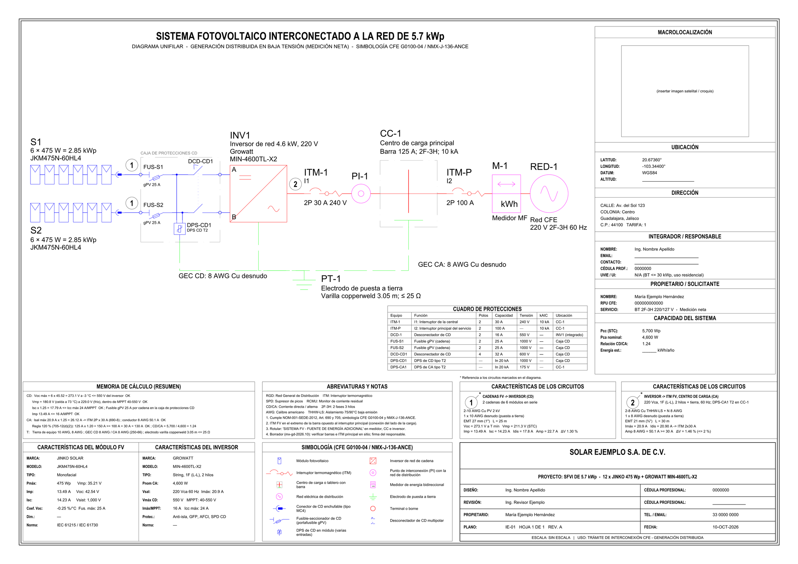
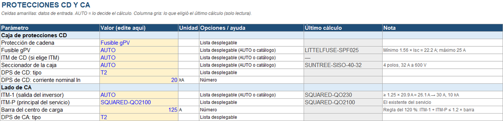
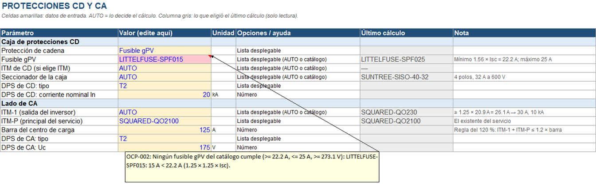

# Guía de usuario de PvUnifilar

PvUnifilar es un plugin de Claude Code, que también se instala en [otros agentes](#11-otros-agentes-copilot-cli-y-antigravity-cli), y que diseña y dibuja el **diagrama unifilar de un sistema fotovoltaico interconectado en México**: baja tensión, residencial, un inversor de cadena, con la NOM-001-SEDE-2012 y los requisitos de interconexión de CFE.

Tú lo pides con tus palabras; un programa calcula y dibuja. Claude solo pregunta, llama al programa y te explica el resultado, así que la misma petición siempre da el mismo plano.

> [!IMPORTANT]
> **Los planos son borradores.** Un ingeniero responsable debe revisarlos y firmarlos antes de cualquier trámite ante CFE o una unidad de verificación.

**Contenido**

1. [Instalación](#1-instalación)
2. [Tu primer diagrama: modo rápido](#2-tu-primer-diagrama-modo-rápido)
3. [Qué hay en la carpeta del proyecto](#3-qué-hay-en-la-carpeta-del-proyecto)
4. [Modo profesional: la hoja de proyecto](#4-modo-profesional-la-hoja-de-proyecto)
5. [El catálogo de equipos](#5-el-catálogo-de-equipos)
6. [Con AutoCAD y sin AutoCAD](#6-con-autocad-y-sin-autocad)
7. [Qué revisa el cálculo](#7-qué-revisa-el-cálculo)
8. [Problemas frecuentes](#8-problemas-frecuentes)
9. [Actualizar y desinstalar](#9-actualizar-y-desinstalar)
10. [Alcance y límites](#10-alcance-y-límites)
11. [Otros agentes: Copilot CLI y Antigravity CLI](#11-otros-agentes-copilot-cli-y-antigravity-cli)

---

## 1. Instalación

### Qué necesitas

| | Para qué | Cómo se instala |
|---|---|---|
| **Claude Code** | Es donde vive el plugin (terminal, app de escritorio o extensión del editor). | <https://claude.com/claude-code> |
| **Git** | Claude Code lo usa para bajar el plugin de GitHub. | Windows: `winget install --id Git.Git -e`. En macOS y Linux casi siempre ya está. |
| **uv** | Baja Python y las dependencias del programa la primera vez. | Windows: `winget install --id=astral-sh.uv -e`. macOS y Linux: `curl -LsSf https://astral.sh/uv/install.sh \| sh` |
| **AutoCAD** (opcional) | Con él también recibes el DWG y el PDF ploteado por AutoCAD. | Un AutoCAD completo con licencia, en Windows. Probado con AutoCAD 2027. |

Después de instalar Git o uv, **cierra y vuelve a abrir Claude Code**: los programas que ya estaban abiertos no ven lo recién instalado.

### Instalar el plugin

En Claude Code, escribe:

```text
/plugin marketplace add edu3250/PvUnifilar
/plugin install pv-unifilar@pvsld
```

O desde una terminal, en un solo paso:

```bash
claude plugin install pv-unifilar --marketplace edu3250/PvUnifilar
```

Reinicia Claude Code para que cargue el plugin.

### El primer arranque

La primera vez, uv descarga unos 60 MB de dependencias. Con una conexión normal tarda entre 15 segundos y un minuto, y Claude Code solo espera 30 segundos a que un programa arranque. Por eso la primera vez puede aparecer como fallido. Tienes dos caminos:

- **Descargarlo antes** (recomendado). En una terminal, una sola vez:

  ```bash
  uvx --from pvsld==0.6.1 pvsld-mcp --version
  ```

  Cuando responda con el número de versión, abre Claude Code.
- **Reconectarlo.** Escribe `/mcp`, elige `pvsld` y reconéctalo. Si vuelve a fallar, espera un minuto a que termine la descarga y reconéctalo otra vez.

Después de la primera vez arranca en unos segundos.

### Comprobar que quedó

Escribe `/mcp`: el servidor `pvsld` (aparece como `plugin:pv-unifilar:pvsld`) debe decir *connected*. Luego pide algo sencillo:

```text
¿Qué módulos hay en el catálogo de PvUnifilar?
```

### Elegir dónde se guardan los proyectos

Por omisión, cada proyecto se guarda en una carpeta `out/` dentro de la carpeta donde trabajas con Claude. Para usar siempre la misma carpeta (por ejemplo `Documentos\Unifilares`):

```text
/plugin configure pv-unifilar@pvsld
```

---

## 2. Tu primer diagrama: modo rápido

Pídelo con tus palabras o con el comando:

```text
Hazme un diagrama unifilar con 12 paneles Jinko de 475 W
```

```text
/pv-unifilar:diagrama 12 paneles Jinko de 475 W
```

Con el comando, Claude usa las herramientas del plugin sin pedirte permiso cada vez. Con una petición normal, Claude Code te pregunta la primera vez si puede usar la skill y sus herramientas: acepta.

**Qué necesita saber:** el módulo (marca y potencia bastan si está en el catálogo) y cuántos son. También puedes dar la potencia del sistema en vez del número de módulos.

Más ejemplos:

```text
/pv-unifilar:diagrama 8 paneles Jinko de 475 W con el inversor Growatt de 3 kW
/pv-unifilar:diagrama un sistema de 5 kW con paneles ET Solar de 550 W
/pv-unifilar:diagrama 10 paneles Jinko 475, llámalo casa_lopez, 40 m del techo al inversor
```

**Lo que el modo rápido supone** cuando no lo dices:

| Dato | Valor por omisión |
|---|---|
| Servicio | CFE en baja tensión, 2F-3H, 220/127 V, medición neta |
| Corriente de falla disponible | 10 kA |
| Interruptor principal y centro de carga | 100 A y barra de 125 A |
| Temperaturas del sitio | mínima −3 °C, máxima 38 °C |
| Recorridos | 25 m de las cadenas al inversor, 30 m del inversor al centro de carga |
| Protección de cadena | fusibles gPV en caja de protecciones, con seccionador y supresor de picos |
| Puesta a tierra | una varilla copperweld de 3.05 m |
| Datos personales | en blanco, para llenarlos a mano |

Todo eso se cambia en el [modo profesional](#4-modo-profesional-la-hoja-de-proyecto).

**Cómo elige el inversor.** Prueba todos los inversores del catálogo con tu arreglo y descarta los que rebasan un límite de tensión, de ventana MPPT, de corriente o de potencia. De los que quedan prefiere una relación CD/CA entre 1.10 y 1.25; si ninguno cae ahí, toma el más cercano. Claude te lo explica en una frase:

> *Se eligió el inversor Growatt MIN-4600TL-X2 (4.6 kW): con 5.70 kWp de módulos la relación CD/CA es 1.24, dentro del rango recomendado de 1.10 a 1.25.*

Si ninguna combinación cumple, no se dibuja nada: Claude te dice por qué y qué puedes cambiar (más o menos módulos, otro inversor u otro módulo).

---

## 3. Qué hay en la carpeta del proyecto

Cada diseño queda en su propia carpeta, `out/<proyecto>/`. Si no le das nombre, se llama por su potencia: `sfv_5p70kWp` es un sistema de 5.70 kWp.

| Archivo | Qué es |
|---|---|
| `unifilar.dwg` | El plano editable en AutoCAD (DWG 2018). Solo con AutoCAD instalado. |
| `unifilar.dxf` | El mismo plano en DXF. Lo abren AutoCAD y casi cualquier programa de CAD. |
| `unifilar.pdf` | El plano en tamaño A3, listo para imprimir. |
| `unifilar.png` | Una vista previa del plano. |
| `memoria_calculo.xlsx` | La memoria de cálculo con **fórmulas vivas**: cada resultado con su límite, su veredicto y su artículo de la NOM. |
| `memoria_calculo.pdf` | La misma memoria para imprimir o entregar. |
| `hoja_de_proyecto.xlsx` | Todos los parámetros del diseño, para cambiarlos en el modo profesional. |
| `resumen_materiales.txt` | La lista de materiales que Claude te muestra en el chat. |
| `especificacion.yaml` | El diseño completo en texto. Sirve para volver a generar exactamente el mismo plano. |

Si la carpeta ya existe, Claude te pregunta antes de reemplazarla.

<p align="center">
  
</p>

**En el plano** encuentras el esquema (cadenas, caja de protecciones de CD, inversor, interruptor de salida, centro de carga, medidor y red), el cuadro de protecciones, el resumen del cálculo, las características de cada circuito con su tubería y el cuadro de título. La [página principal](../README.md#el-plano) muestra cada parte.

**En la memoria de cálculo** cambia un dato de entrada y las comprobaciones se recalculan. Las longitudes del resumen de materiales son de un sentido y sin desperdicio: agrega la holgura de obra.

---

## 4. Modo profesional: la hoja de proyecto

Úsalo cuando quieras decidir tú: el inversor, las cadenas, un fusible, un calibre, la tubería, los datos del servicio o los datos del cliente.

### Paso a paso

1. **Consigue la hoja.** Cada diseño del modo rápido ya deja en su carpeta una `hoja_de_proyecto.xlsx` llenada con lo que se calculó: puedes editar esa y saltar al paso 2. Para empezar de cero:

   ```text
   /pv-unifilar:pro nuevo
   ```

   Claude te pide un nombre corto para el proyecto (letras, números, `-` y `_`; por ejemplo `casa_lopez`) y te dice dónde quedó la hoja.
2. **Llena las celdas amarillas** en Excel. Deja `AUTO` donde quieras que decida el cálculo.
3. **Guarda y cierra el archivo.** Debe seguir en la carpeta del proyecto con el nombre `hoja_de_proyecto.xlsx`.
4. **Pide el diseño** con el nombre del proyecto:

   ```text
   /pv-unifilar:pro casa_lopez
   ```

   Si partiste de un diseño del modo rápido, el nombre es el de su carpeta: `/pv-unifilar:pro sfv_5p70kWp`.

<p align="center">
  
</p>

### Qué puedes fijar

| Hoja | Parámetros |
|---|---|
| **Proyecto** | Nombre del proyecto, propietario, dirección, coordenadas, RPU, número de servicio y de medidor, tarifa, sistema de suministro (1F-2H o 2F-3H), tensión, corriente de falla, ingeniero responsable, cédula, empresa, UVIE y fecha. |
| **Equipos** | Módulo, cantidad de módulos, número de cadenas, módulos por cadena e inversor. |
| **Protecciones** | Fusible gPV o interruptor de CD por cadena, seccionador de la caja, supresores de CD y CA, interruptor de salida del inversor (ITM-1), interruptor principal (ITM-P) y barra del centro de carga. |
| **Conductores** | Longitudes, cable y calibre de CD, calibre de CA, tubería EMT y caída de tensión máxima de cada lado. |
| **Tierra** | Electrodo, resistencia de diseño y conductores del electrodo. |

Los equipos se eligen de listas desplegables que salen del catálogo, incluidos los que tú agregaste.

### Las tres reglas de la hoja

- **Lo que fijas se respeta y se revisa; nunca se cambia en silencio.** Si pones un fusible de 10 A donde hacen falta 25 A, el cálculo no lo cambia: te avisa.
- **`AUTO` deja decidir al cálculo.** La columna gris "Último cálculo" te muestra qué eligió.
- **Los datos personales pasan tal como los escribes.** Propietario, dirección, RPU, cédula y coordenadas no se validan ni se corrigen: son tu responsabilidad. Lo que dejes vacío queda como línea en blanco en el plano.

### Cuando algo no cumple

No se dibuja nada. Claude te lista cada celda con su razón y en la carpeta aparece `hoja_de_proyecto_revisar.xlsx`: una copia de tu hoja con esas celdas en rojo y la razón en un comentario.

<p align="center">
  
</p>

Corrige **tu** `hoja_de_proyecto.xlsx`, no la copia, y vuelve a pedir el diseño. Cuando todo cumple, tu hoja queda con la columna "Último cálculo" al día.

---

## 5. El catálogo de equipos

El programa nunca inventa datos de un equipo: todo sale de fichas tomadas de la hoja técnica del fabricante.

**Lo que ya viene incluido** (cada ficha revisada contra su hoja técnica):

| Tipo | Equipos |
|---|---|
| Módulos | Jinko de 460 a 480 W y de 625 a 650 W; ET Solar de 520 a 550 W |
| Inversores | Growatt MIN de 2.5 a 6 kW; Huawei SUN2000 de 2 a 6 kW |
| Fusibles gPV 10×38 | Littelfuse SPF; Eaton Bussmann PV |
| Interruptores de CD | Schneider Acti9 C60PV-DC; Suntree SL7N-63 |
| Seccionador FV | Suntree SISO-40 |
| Interruptores de CA | Square D QO de 2 polos |
| Cable fotovoltaico | Viakon PV Wire 2000 V |

Para ver la lista completa, pregúntale a Claude: *"¿qué inversores hay en el catálogo?"*.

**Agregar un equipo que no está.** Necesitas su hoja técnica en PDF:

```text
/pv-unifilar:catalogo C:\Descargas\hoja-tecnica-del-panel.pdf
```

1. Claude lee la hoja técnica y te muestra los valores en una tabla, con la página de donde salió cada bloque.
2. **Tú los comparas con el PDF y confirmas.** Si algo está mal, dilo y se corrige.
3. Solo entonces se guarda. Desde ese momento el equipo aparece en tus diseños y en las listas de la hoja de proyecto.

También pasa solo: si pides un diagrama con un equipo que no está, Claude te pide su hoja técnica y sigue con el diseño cuando lo confirmas.

**Dónde queda.** En tu **catálogo local**, que nunca sale de tu computadora:

- Windows: `%APPDATA%\pvsld\catalogo`
- macOS y Linux: `~/.local/share/pvsld/catalogo`

Ahí están las fichas (archivos `.yaml`) y, en `hojas_tecnicas`, los PDF. Para quitar un equipo, borra su ficha. Un equipo que tú agregas lo revisas tú: el programa comprueba que los valores sean coherentes, no que coincidan con el PDF.

---

## 6. Con AutoCAD y sin AutoCAD

El programa busca AutoCAD solo; no hay nada que configurar.

| | Con AutoCAD | Sin AutoCAD |
|---|---|---|
| Plano editable | `unifilar.dwg` y `unifilar.dxf` | `unifilar.dxf` |
| PDF del plano | ploteado por AutoCAD | generado por el programa (A3 vectorial) |
| Memoria, hoja de proyecto y materiales | igual | igual |
| Tiempo por diseño | unos 15 segundos | unos 5 segundos |

- AutoCAD trabaja por dentro, sin abrir su ventana, y no toca los dibujos que tengas abiertos.
- Si AutoCAD falla (por ejemplo, la licencia no está activa), el diseño no se pierde: recibes el DXF y el PDF del programa, y Claude te dice que AutoCAD no terminó.
- El DXF abre en AutoCAD con las mismas capas, bloques y atributos que el DWG; puedes guardarlo como DWG a mano.
- Para no usar AutoCAD en un diseño, dilo: *"sin AutoCAD"*.

---

## 7. Qué revisa el cálculo

Antes de dibujar, el diseño pasa por un paquete de reglas con versión (`mx-gd-2026.10`). Un diseño que falla una regla obligatoria no se dibuja.

| Regla | Qué comprueba | Referencia |
|---|---|---|
| VOLT-001 | La tensión de la cadena en el día más frío no rebasa la entrada del inversor | NOM 690-7(a) |
| STR-001 | La tensión de operación en caliente queda dentro de la ventana MPPT | NOM 110-3(b), fabricante |
| STR-004 | La corriente de cortocircuito no rebasa la entrada del inversor | NOM 690-8(a)(1) |
| STR-007 | La potencia del arreglo y la relación CD/CA: aviso arriba de 1.35, rechazo arriba de 1.50 | fabricante |
| CON-003 | Cada conductor está protegido por su interruptor o fusible | NOM 240-4, 690-8(b) |
| CON-006 | El llenado de la tubería EMT | NOM 358-22, capítulo 10 |
| PCC-002 | La regla del 120 % de la barra del centro de carga | NOM 705-12(d)(2) |
| MET-001 | Medidor bidireccional en el punto de interconexión | requisitos de interconexión |
| DIS-003 | Desconectador a la salida del sistema fotovoltaico | requisitos de interconexión |
| DIS-004 | Desconectador bidireccional del servicio | requisitos de interconexión |

Durante el dimensionamiento también se eligen y comprueban: el fusible o interruptor de cada cadena (al menos 1.56 × Isc y no más que el fusible máximo del módulo), el calibre de cada conductor por ampacidad con sus factores de temperatura y agrupamiento, y la caída de tensión de cada circuito.

---

## 8. Problemas frecuentes

| Qué ves | Por qué pasa | Qué hacer |
|---|---|---|
| Claude dice que el servidor `pvsld` no está conectado, o `/mcp` lo muestra como fallido | Es el primer arranque y la descarga tardó más de 30 segundos | Reconéctalo desde `/mcp`, o descárgalo antes como dice [el primer arranque](#el-primer-arranque) |
| Sigue sin conectar | Claude Code no encuentra `uvx` | En una terminal, `uv --version` debe responder. Si no, instala uv. Después cierra y vuelve a abrir Claude Code |
| `/plugin marketplace add` falla | Falta Git, o no hay conexión a GitHub | Instala Git y vuelve a abrir Claude Code |
| "El módulo no está en el catálogo" | El catálogo incluido es pequeño | Dale a Claude la hoja técnica en PDF: [agregar un equipo](#5-el-catálogo-de-equipos) |
| "Ninguna configuración cumple" | Con ese número de módulos ningún inversor del catálogo queda dentro de sus límites | Cambia el número de módulos, elige otro inversor o agrega el tuyo al catálogo |
| "La carpeta ya existe" | Ya hay un proyecto con ese nombre | Dile a Claude que lo reemplace, o dale otro nombre |
| No se puede escribir un archivo | El plano está abierto en AutoCAD o la hoja en Excel | Cierra el archivo y vuelve a pedirlo |
| No hay `unifilar.dwg` | AutoCAD no está instalado o no pudo terminar | Claude te dice la razón. Abre el DXF en AutoCAD y guárdalo como DWG |
| Claude te pide permiso para usar una herramienta | Usaste una petición normal en vez del comando | Acepta, o usa los comandos `/pv-unifilar:…` |
| Aparece una carpeta `ErrorReports` junto a tu DWG | La crea AutoCAD, no el plugin | Puedes borrarla |

Si algo más falla, copia el mensaje de Claude y abre un reporte en <https://github.com/edu3250/PvUnifilar/issues>.

---

## 9. Actualizar y desinstalar

Las dos cosas se hacen desde `/plugin` en Claude Code, o desde una terminal.

**Actualizar** a una versión nueva (los equipos nuevos del catálogo, las reglas, las plantillas y las correcciones llegan juntos con cada versión):

```bash
claude plugin marketplace update pvsld
```

```bash
claude plugin update pv-unifilar@pvsld
```

Reinicia Claude Code. En el primer arranque después de actualizar, el programa se descarga de nuevo; suele tardar menos que la primera vez.

**Desinstalar:**

```bash
claude plugin uninstall pv-unifilar@pvsld
```

Tus proyectos y tu catálogo local no se borran.

---

## 10. Alcance y límites

**Lo que hace esta versión**

- Sistemas interconectados sin baterías, en baja tensión, con servicio de CFE 1F-2H o 2F-3H.
- Un inversor de cadena y hasta dos cadenas.
- Conductores de cobre en tubería EMT.

**Lo que no hace**

- Sistemas con baterías, microinversores, varios inversores, o servicio trifásico o en media tensión.
- El trámite de interconexión ni sus formatos: entrega el plano, la memoria y la lista de materiales.
- No sustituye la revisión de un ingeniero: el resultado es un borrador.

**Dónde funciona**

- En Claude Code (terminal, app de escritorio o extensión del editor), en Copilot CLI y en Antigravity CLI. No en claude.ai en el navegador, porque el programa corre en tu computadora.
- Probado en Windows y Linux; en macOS no se ha probado. El DWG y el PDF de AutoCAD, solo en Windows con un AutoCAD completo.

Este proyecto no está afiliado a CFE, a Autodesk ni a ningún fabricante. Código y documentación técnica: <https://github.com/edu3250/PvUnifilar> (licencia MIT).

---

## 11. Otros agentes: Copilot CLI y Antigravity CLI

El mismo plugin funciona fuera de Claude Code. Lo que calcula y dibuja es el mismo programa; cambia quién conversa contigo.

| Agente | Estado | Modelo con el que se probó |
|---|---|---|
| Claude Code | Probado | Claude |
| GitHub Copilot CLI | Probado (versión 1.0.96) | el suyo |
| Google Antigravity CLI | Probado (versión 1.3.4) | el suyo |
| Gemini CLI | Sin probar: desde junio de 2026 no admite cuentas personales de Google | |
| Codex CLI | Sin probar | |

En todos necesitas **uv** y **Git**, igual que en [la instalación](#qué-necesitas).

### GitHub Copilot CLI

```bash
copilot plugin marketplace add edu3250/PvUnifilar
```

```bash
copilot plugin install pv-unifilar@pvsld
```

### Google Antigravity CLI

Antigravity instala un plugin desde una carpeta, así que primero se baja el repositorio:

```bash
git clone https://github.com/edu3250/PvUnifilar
```

```bash
agy plugin install PvUnifilar/plugins/pv-unifilar
```

Instala la carpeta `plugins/pv-unifilar`, no el repositorio completo.

### Cómo se usa

Pídelo con tus palabras; el agente carga las instrucciones por su cuenta:

```text
Hazme un diagrama unifilar con 12 paneles Jinko de 475 W
```

Los comandos `/pv-unifilar:…` son de Claude Code. Aquí el modo profesional y el catálogo también se piden hablando:

```text
Dame una hoja de proyecto nueva para el proyecto casa_lopez
```

```text
Diseña el proyecto casa_lopez con su hoja de proyecto
```

```text
Agrega al catálogo el panel de esta hoja técnica: C:\Descargas\panel.pdf
```

El agente te pedirá permiso antes de usar cada herramienta de `pvsld`: acéptalo.

### Dónde quedan los proyectos

En una carpeta `PvUnifilar` dentro de tu carpeta de usuario (en Windows, `C:\Users\tu_usuario\PvUnifilar`), una subcarpeta por proyecto. En Claude Code siguen en `out/` de la carpeta donde trabajas.

### El primer arranque

Igual que en Claude Code, la primera vez se descargan las dependencias. Conviene hacerlo antes, una sola vez:

```bash
uvx --from pvsld==0.6.1 pvsld-mcp --version
```

### Cualquier otro cliente MCP

El plugin es una capa sobre un servidor MCP estándar. En un cliente que no lee plugins, agrega el servidor a su configuración:

```json
{
  "mcpServers": {
    "pvsld": {
      "command": "uvx",
      "args": ["--from", "pvsld==0.6.1", "pvsld-mcp"]
    }
  }
}
```

El servidor ofrece los tres flujos como prompts (`diagrama`, `pro`, `catalogo`); los clientes que muestran prompts los listan como comandos.
